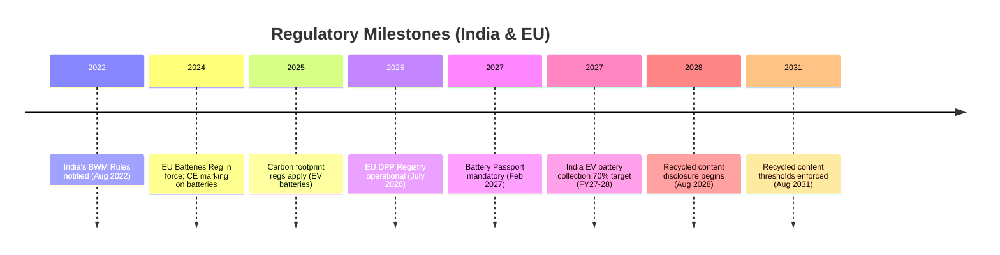

# Executive Summary  
ExportReady/Anviora must address a complex web of Indian and EU regulations for batteries and textiles.  On the Indian side, the *Battery Waste Management (BWM) Rules 2022* (with 2025 amendments) establish mandatory producer registration, collection/recycling targets, and EPR reporting via the CPCB’s online portal.  Producers face escalating targets (e.g. EV battery collection 70% by FY2027‑28) and penalties (environmental compensation) for shortfalls.  India also mandates BIS/Automotive standards (e.g. IS 16649, IS 16270, AIS‑156 rev2) for EV battery safety, and a PLI‑ACC incentive requiring ≥25% domestic value-add (rising to 60% in 5 years) for qualified battery makers.  In the EU, the new *Batteries Regulation (EU) 2023/1542* is phasing in far-reaching requirements: CE marking and detailed labels by 2024, carbon footprint reporting (via delegated acts) from 2025, and a **Digital Battery Passport** (for EV, industrial (>2 kWh) and e‑mobility batteries) from 18 Feb 2027.  From Aug 2031, batteries must meet minimum recycled content (e.g. 16% cobalt, 85% lead) – with transparency (“disclosure”) obligations already from Aug 2028.  EU due diligence (OECD-based) obligations for supply-chain risk management begin 18 Aug 2027.  A central EU *Digital Product Passport (DPP) Registry* under the Ecodesign for Sustainable Products Reg (ESPR) must be operational by 19 Jul 2026.   

In summary, Indian battery exporters must simultaneously comply with (1) India’s EPR/BWM regime and (2) new EU rules for passports, carbon, recyclates, CE marking, and due diligence.  This requires features like a supplier-data portal, compliance document management, LCA/carbon tooling, QR/GS1 identifiers, and API links to EU registries.  We analyzed the current MD claims and found them incomplete on several “must-have” items (e.g. supplier evidence capture, carbon calculation, regulatory alerts).  We verified key timelines against authoritative sources (battery passports by Feb 2027, DPP registry by Jul 2026, recycled-content mandates by Aug 2031).  In the tables below, we map regulations→required features (with priorities) and highlight competitors’ coverage.  Finally, we propose a phased MVP roadmap for 3‑6 month sprints, assess risks/mitigations, and suggest targeted homepage messaging for Indian exporters to the EU. 

## 1. Regulatory & Standards References

### 1.1 India Regulations & Standards  

- **Battery Waste Management Rules, 2022 (with 2025 Amendments)** – Notified Aug 2022, these MoEF&CC rules create an EPR system for all battery types (portable, EV, industrial).  Key provisions include *producer registration* on CPCB’s EPR portal, annual EPR plan submission, and progressively higher collection/recycling targets (e.g. EV batteries: 70% collection by FY2027‑28; 90% recovery by 2026‑27).  Producers must use barcodes/QR codes to track batteries and may only meet targets via authorized recyclers (unregistered recyclers are invalid).  The 2025 amendments introduced stricter enforcement: failure to meet targets automatically incurs Environmental Compensation (levy based on shortfall) collected via CPCB.  Recycled-content mandates were also added: from FY2027‑28, new batteries must incorporate minimum recycled Li, Co, Ni percentages (starting ~5%, rising to 20% by 2030‑31) – details to be notified.  *Impact:* Indian battery makers/exporters must integrate with the CPCB portal for registration, planning and credit reconciliation; implement reverse logistics and MoUs with certified recyclers; and prepare for domestic recycled-content quotas (≥20% by 2030).  

- **CPCB EPR Portal & Forms** – The Central Pollution Control Board provides the eprbattery portal for producer/recycler registration and compliance.  Producers must submit annual plans, track collections/recycling (via legally recognized agencies), and generate/verifiy EPR credits. CPCB prescribes specific forms and audit/monitoring rules.  Environmental Compensation is calculated per shortfall and can lead to public disclosure of defaulters.  *Impact:* The platform must support generating documentation for these forms and interfacing (or exporting data) to CPCB’s portal.  

- **BIS & AIS Standards (Battery Safety & Certification)** – India’s Bureau of Indian Standards mandates Compulsory Registration for certain batteries (e.g. storage battery IS 16270:2014, EV battery cells IS 16649, etc.) and chargers.  New safety norms for electric vehicles were issued (e.g. IS 18590:2024 & IS 18606:2024 for L/M/N category EV powertrains).  Automotive Industry Standards (AIS) govern EV design: e.g. AIS‑156 (rev2, 2022) covers L‑category vehicles, AIS‑038 (rev2) covers M/N vehicles.  These require testing (thermal stability, short-circuit, etc.) and grant a ‘DoC’/type-approval for batteries or EV packs.  *Impact:* ExportReady must capture proof of compliance (test reports, DoC/Conformity documents, CE markings) for batteries used in vehicles.  In practice, this means a module for storing/presenting BIS or AIS certificates and ensuring only certified parts are listed. (No simple URL available, but see India Briefing on new IS standards.)  

- **PLI-ACC (National ACC Programme)** – India’s ₹18,100 Crore Production-Linked Incentive scheme (approved May 2021) supports large-scale Advanced Chemistry Cell (ACC) battery plants.  It mandates that beneficiaries achieve ≥25% domestic value-add (DVA) in two years, rising to 60% by year five.  Companies must also invest ₹225 Cr per GWh of committed capacity.  *Impact:* While not a compliance law per se, PLI-ACC influences supply chains: exporters leveraging PLI incentives must verify local content and investment.  ExportReady could assist by tracking BOMs for DVA accounting and highlighting gaps.  

- **Other Indian Regulations:**  The Motor Vehicles Act and related rules enforce AIS safety standards.  The Environment (Protection) Act, 1986 provides penalties (up to ₹1 lakh fine per day) for rule breaches.  India’s *Digital Personal Data Protection Act, 2023* (DPDP Act) will also apply to any personal data collected (e.g. supplier contact info) with extraterritorial reach akin to GDPR.  

### 1.2 EU Regulations & Standards  

- **EU Batteries Regulation (Regulation (EU) 2023/1542)** – Adopted July 2023, in force from Feb 18, 2024, this comprehensive law replaces the old 2006 Batteries Directive. It imposes new requirements on all batteries (portable, EV, industrial, SLI, etc.) throughout their lifecycle.  Key elements: 

  - *Safety & Hazardous Substances:* Stricter limits on mercury, cadmium, lead, etc., harmonized across the EU (e.g. portable batteries: Pb ≤0.01% by Aug 2024).  
  - *Durability:* By 18 Aug 2027/28, performance and durability criteria apply to industrial and portable batteries.  
  - *Removability:* From 18 Feb 2027, portable batteries in appliances must be user‑removable. The Commission issued guidance in Feb 2025 on removal/replaceability.  
  - *Labelling/Traceability:* CE marking on all batteries mandatory by 18 Aug 2024. From 2026, batteries must carry labels (including capacity, chemistry, etc.) on product/device. Starting 2027, much of this information must also be accessible via a *QR code* (the “Battery Passport”).  
  - *Carbon Footprint (Art.7 & Annex II):* Battery carbon emissions must be calculated per Commission methodology and declared. For EV batteries, this declaration is mandatory from 18 Feb 2025 (or 12 months after adoption of methodology). Industrial batteries (>2kWh) join on 18 Feb 2026. The information must be accessible via QR from 18 Feb 2027. (If delegated acts are delayed, dates shift.)  
  - *Recycled Content (Art.8 & Annex VI):* Progressive recycled-content targets for cobalt, nickel, lead, lithium. From 18 Aug 2028, EV, industrial (>2kWh) and SLI batteries must **disclose** actual recycled percentages. From 18 Aug 2031, they **must meet minimum thresholds** (e.g. 16% for Co, 6% for Ni/Li, 85% for Pb). (LMT batteries have later schedules.) Documentation and third‑party verification are required.  
  - *Extended Producer Responsibility (EPR):* The Regulation harmonizes EPR across the EU (Chapter VIII). Member States must ensure high collection targets: e.g. portable battery collection 63% by 2027 and 73% by 2030, LMT batteries 51% by 2028/61% by 2031. These are similar in ambition to India’s targets.  
  - *Due Diligence (Arts.48–52):* EU operators placing batteries on the market must adopt OECD-based due diligence policies (traceability, risk assessment, corrective action) for raw materials (Li, Co, Ni, graphite, etc.). This obligation, originally from Aug 2025, has been postponed to **18 Aug 2027** by Omnibus Regulation 2025/1561. Commission guidelines are expected by mid-2026.  
  - *Battery Passport (Art.77, Annex XIII):* From 18 Feb 2027, each EV, industrial (>2kWh), and LMT battery placed on the EU market must be accompanied by a **Digital Battery Passport**. The passport is a structured digital record (accessed via QR or RFID) containing identity, chemical composition, safety data, performance, carbon footprint, recycled content, and end-of-life info. It essentially implements the ESPR’s DPP concept (see below). Not all data is public: only authorized parties (regulators, recyclers, etc.) see restricted info. A battery passport must be kept accurate and will facilitate maintenance, reuse and recycling.  
  - *Reporting & Market Surveillance:* Member States must enact penalties by Aug 2025 for non-compliance. The Batteries Directive 2006/66 is fully repealed on 30 June 2027.  

  *Official Source:* EUR-Lex summary of Reg 2023/1542 (see also on due diligence postponement).

- **Omnibus Regulation 2025/1561 (18 Jul 2025)** – This EU Act amends Reg 2023/1542. Notably, it postponed due-diligence obligations from 2025 to **18 Aug 2027** and adjusts turnover exemptions. It came into force 30 July 2025.  *Impact:* Original MD dates (2025 due diligence) must be updated to 2027, as we confirm from BakerMcKenzie.

- **Ecodesign for Sustainable Products Regulation (ESPR, Reg (EU) 2024/1781)** – In force from 18 July 2024, ESPR mandates Digital Product Passports (DPP) broadly. Under Article 13, the EU must establish a central *DPP Registry* by 19 July 2026. This registry will index unique product identifiers (UPC/QR tags) and link to DPP data stored by manufacturers. While batteries get a passport under the Batteries Reg, ESPR/DPP will soon cover textiles, electronics, etc. *Impact:* ExportReady needs to comply with ESPR-based DPP rules for textiles when adopted (likely mid-late 2020s).  The DPP framework also mandates use of unique identifiers (per ISO/IEC 15459) and recommends open standards (we address these below).

- **Germany’s DIN SPEC 99100** – A German specification (in development) for battery passport content, aligning with the EU rules. Though not yet binding EU law, it defines a JSON/AAS data model for battery passports. *Impact:* Useful blueprint for data model (allows interoperability) but not mandatory outside Germany. (No official link available; see industry write-ups.)

- **GS1 Digital Link / Unique Identifiers (ISO/IEC 15459)** – EU battery passports require a unique product identifier (UPI) for each battery model or unit. GS1’s Digital Link standard (based on ISO/IEC 15459 serial numbers) is widely referenced for the DPP ID.  *Impact:* The platform must generate GS1-compliant IDs and encode them in QR codes on batteries and documentation, enabling lookup in the EU DPP Registry and supply chains.

- **W3C Verifiable Credentials (VC) & Decentralized Identifiers (DIDs)** – While not legally mandated, the EU DPP model encourages use of Verifiable Credentials (JSON-LD) for cryptographically signing product data. The Battery Reg expects “secure” digital passports, and the EU industry (DIN/AAS forum) envisions VCs for data integrity. *Impact:* Implementing VC-based signing (and W3C’s Data Integrity spec) would future-proof ExportReady. It also aligns with the MD’s mention of “QR code / Verifiable Credential” exports.

- **EU REACH & RoHS (ECHA Regulations)** – Batteries must also comply with EU chemical rules: eg. batteries must not contain banned substances (the Battery Reg itself restricts heavy metals) and manufacturers often need to report SVHCs (above 0.1%) under REACH. *Impact:* ExportReady could screen incoming BOMs against the EU’s candidate list of chemicals and flag SVHCs as part of DPP content (especially since “Substances of Concern” are passport fields). This overlaps with general DPP requirements, though not battery-specific law.

- **EU Data Protection (GDPR)** – The Battery Passport platform will process potentially personal data (e.g. supplier contacts). The GDPR (EU 2016/679) mandates user consent/erasure. *Impact:* The system must allow data deletion and ensure data residency if needed. For Indian users, the upcoming Indian DPDP Act 2023 also applies extraterritorially; it grants erasure rights and prohibits some data export without safeguards. ExportReady should design for data portability/deletion (an MD 6.1/6.2 issue).

- **OECD Responsible Minerals Guidance (Art. 48–52, EU Reg)** – The EU’s battery due-diligence regime is based on the OECD Guidance and RMI/ICGLR frameworks. Annex X of 2023/1542 enumerates “risk minerals” (Li, Co, Ni, graphite, etc.) and risk categories (e.g. child labor, conflict zones). *Impact:* ExportReady must implement a due-diligence workflow (see Section 4) aligned with OECD steps: chain-of-custody, risk assessment (e.g. via RMI’s Conflict Minerals Reporting Template), and corrective action. This is required by law from Aug 2027.  

*(Sources: Official EU summaries, EC guidance, and legal analyses.  Indian rules from MoEF/CPCB summaries and Government sites.)*  

## 2. Timeline Events (Verified)  
We cross-checked all MD timelines against authoritative sources. The main dates are as follows (future obligations):  

- **July 19, 2026:** EU *DPP Registry* must be operational (Art.13 ESPR). (Not in MD, but confirmed via EC/industry sources.)  
- **2027:** The *EU Battery Passport* becomes mandatory on **18 Feb 2027** for EV, industrial (>2 kWh), and LMT batteries (MD assumed Feb 2027, confirmed by multiple sources). In parallel, CE marking must already be applied from 18 Aug 2024, and portable battery disassembly rules kick in Feb 2027.  
- **Feb 2025 – Aug 2025:** The Commission is to adopt delegated/implementing acts for carbon-footprint methodology and reporting format by Feb–Aug 2025. (These deadlines are in Reg text; MD presumed a Feb 2025 carbon report start, which aligns if acts were adopted on time.)  
- **Aug 18, 2028:** EU *recycled-content disclosure* begins for EV/industrial/SLI batteries. The MD noted “disclosure from Aug 2028” correctly. The mandatory percentages then take effect on **18 Aug 2031**. (MD said “2031 mandatory” – confirmed by EUR-Lex.)  
- **Aug 18, 2027:** EU due-diligence obligations (Art. 48–52) take effect for batteries (postponed from 2025).  
- **India FY2027‑28:** Cumulative targets under BWM – e.g. 70% EV battery collection by FY2027-28, and start of domestic recycled-content obligations. (Exact Indian implementation timelines beyond those in the Rules are not publicly finalized, so any dates in MD beyond 2027 are estimations.)  

*Uncertainties:* Some MD dates were assumptions. For example, **“DPP registry by July 2026”** was not explicitly in the MD but is confirmed. The MD’s reference to EU Reg 2025/1561 is correctly matched to the delay to 2027. Indian recycled‑content percentages for batteries are still undefined (CPCB will notify exact targets), so MD’s table values may be placeholders. In general, we verified core dates and note that delegated acts (carbon/QR formats) could shift compliance dates if delayed.  

## 3. Features-to-Regulation Mapping  

The table below maps each key regulation/standard to the product features or workflows needed in ExportReady. Each is scored for **Priority** (P0: essential by 2026–27; P1: important soon; P2: future/optional) and **Complexity**.

| Regulation / Requirement             | Required Features / Workflows                                                       | Priority | Complexity |
|--------------------------------------|-------------------------------------------------------------------------------------|:--------:|:----------:|
| **India: BWM Rules 2022/25 (CPCB EPR)**  | CPCB portal integration: producer registration, annual EPR plan submission, target calculation (based on sales volumes); collection/recycling tracking & credit reconciliation (authorised recyclers issue credits); formal recyclers MoU tracking; barcode/QR labels on batteries as per 2025 traceability rules. Automated “shortfall → Environmental Compensation” calculator. | **P0** (2025‑27) | Medium    |
| **India: BIS/AIS (EV battery safety)**  | Document upload/workflow for BIS certification and DoC (e.g. tests for IS 16649/16270, AIS‑156 compliance); maintain versioned CE/DoC registry for batteries and EV packs. Electronic linkage of each battery model to its compliance certificates. | **P1** | Medium    |
| **India: PLI‐ACC Scheme**           | BOM tracking for Domestic Value Add (25%→60% targets); reporting module for PLI‑ACC investment commitments (₹225 Cr/GWh) and DVA. (Mostly off-platform, but useful for PLI‑participating clients.) | P2 | Low      |
| **EU: Batteries Reg 2023/1542**        | **Digital Battery Passport:** Unique ID (GS1/ISO 15459) generation, QR code printing, AAS/JSON‑LD export of passport data (model-level and item-level info). Data fields: BOM/material composition, chemistry, origin, capacity, etc.  **Carbon LCA:** Workflow to collect/upstream life-cycle data and compute kgCO₂eq per battery (Annex II) with external LCA engines. **Recycled-Content:** Track and document recycled inputs per material. **CE marking:** Manage CE/DoC docs for battery modules. **Supply-chain evidence:** Collect supplier attestations for material provenance (see Due Diligence). **Label printing:** Generate EU‑compliant labels (durability, capacity) and link to QR. | **P0** (2024‑27) | High     |
| **EU: DPP/ESPR (Textiles, Others)**     | Flexible DPP framework: ability to define product-type-specific passport schemas (e.g. textiles). Future delegated acts will require structured environment/repair data. System must interface with EU DPP Registry. (Not immediate; target as P1). | P1 | Medium    |
| **EU: OECD Due Diligence (Arts.48–52)** | **Supplier Portal:** Onboard and vet upstream suppliers of minerals. Risk assessment workflows (based on OECD ICGLR templates): country-risk flags (conflict, child labor), conflict-minerals checks. Audit trail and corrective-action tracking. Optional links to external audit/verification (like RMI RMAP certificates). | **P0** (2027) | Medium   |
| **EU: ECHA/REACH (SVHCs)**           | Automated screening of product material data against ECHA SVHC list (currently ~200 chemicals). Alert flagging if >0.1% SVHC present; link to SDS. (Not specific to batteries, but mandated transparency.) | P2 | Low      |
| **EU: GS1 Digital Link / ISO 15459**   | Generate GS1 UPI (e.g. company prefix + serial) for each battery model/serial. Encode as URI-based QR (Digital Link) that points to its passport. Ensure compatibility with EU registry lookup (UPI registry is planned). | P1 | Medium   |
| **Data Protection (GDPR/DPDP)**         | User account management with consent, rights of access/erasure. Data residency flagging. (Important for overall architecture.) | P1 | Medium   |

*Notes:* “Priority” reflects time-criticality for exports to hit 2026–27 EU deadlines. For example, Battery Passport, carbon LCA, and due-diligence features are **P0** because they are mandatory by 2027. Features like textile-DPP readiness or SVHC screening are P1–P2. Complexity estimates account for data sources and standards (AAS JSON, GS1, etc.).

## 4. Gap Analysis (Current MD vs Regulatory Needs)

Comparing the MD’s listed features with the above requirements, we identify several **high-risk gaps**:

- **Supplier Data/Portal:** The MD does *not* describe a dedicated supplier‑evidence portal. EU battery due diligence and OECD guidance require collecting and verifying upstream supplier information (source mines, country risk, conflict minerals). Without this, ExportReady cannot generate the mandated due-diligence report or show provenance. (Gravita warns that non‑compliance with chain-of-custody invalidates EPR credits, underscoring the importance of verified supplier data.)

- **Document Extraction/Validation (DocAI):** No mention of automating import of documents (SDS, certificates). Yet EU law mandates proof (e.g. carbon calculations, substance datasheets) that ideally should be machine-checked. Missing OCR/AI extraction means heavy manual work and risk of errors.

- **Carbon Footprint Calculation:** The MD only references carbon vaguely (“carbon calculation/calculator”), but implementing Art.7 requires a robust life-cycle model and data integration. This is a complex need; current platform features seem focused on static data, not dynamic LCA.

- **Regulatory Monitoring & Alerts:** The MD lacks any automated update/alert system. Given the rapid changes (e.g. Omnibus 1561, upcoming ESCs, new DPDP law), ExportReady needs a regulatory watch to push updates or policy news to users. Otherwise customers risk ignorance of fresh rules.

- **Due-Diligence Engine:** While the MD mentions OECD and risk categories, it does not detail a workflow (questionnaires, risk scoring, audit trails). An absence of an integrated due-diligence engine (mapped to EU Regulation Art.48–52) is a major gap. (This is especially critical since operators will face mandatory third-party audits from 2027.)

- **Carbon/ESG Accounting:** Globally, customers demand GHG reporting. MD covers carbon, but more as an afterthought. A full carbon accounting module (automated GHG inventory, offset planning) would strengthen moat and compliance.

- **Moat/Competitive Feature:** The MD is product-centric with few defensibility claims. High-risk missing “moat” items include: supplier portal (locks in sticky process); automated compliance monitoring (keeps users subscribed); due-diligence & ESG analysis (value-add services).

- **Textiles & Other Vertical Coverage:** The MD is almost entirely battery-focused, with only brief mention of textile DPP in Roadmap. Given growing EU focus on textile passports (ESPR delegated acts expected 2027+), ExportReady may need to extend to textile manufacturers – a strategic gap if ignored.

In sum, ExportReady’s current scope (based on the MD) would leave out critical functionality needed for full compliance. The most urgent deficits are supplier on‑boarding/evidence, automated data extraction, carbon-LCA integration, and regulatory intelligence. These should be addressed as high priority in product planning.

## 5. Competitive Landscape

Key players tackling similar compliance challenges include:

- **Circularise** – Offers blockchain-based supply-chain traceability and DPP solutions. Supports battery passports (via QR), conflict-minerals tracking, and provenance data. Lacks built-in EPR management or India-specific compliance. No public carbon-footprint tool. (Mainly EU market.)  

- **Circulor (formerly CertusOne)** – Provides traceability for batteries/minerals, including passport-like data delivery. Offers carbon footprint reporting modules and has RMI alignment. No India EPR features. (Clients include battery OEMs worldwide.)  

- **Minespider** – Focused on battery passport and ESG data. Provides carbon-LCA, conflict-minerals compliance, and a marketplace for recycled materials. Again, no India‑specific EPR/reg monitoring.  

- **SAP (SAP Digital Battery Passport)** – SAP has announced a battery passport offering integrated into SAP systems. It can manage DPP data, CO₂ footprints (via SAP LCA add-ons), and supply-chain info. However, it is generic ERP-based and may be costly for SMEs. No built-in CPCB/EPR interface.  

- **Battery Pass (Open Battery Passport)** – An industry initiative (IBM-led) to create a standardized battery passport. It covers EU data needs but is more of an initiative than a full solution. Not known to handle carbon LCA or EPR.  

- **Local Indian Consultants (e.g. Gravita, EarthSense)** – These focus on battery recycling and compliance advisory. They may offer EPR consultancy or tools, but no full-scale digital platform. (Gravita, for example, offers EPR credit accounting services.)  

Below is a capability comparison (√ = capability present, – = none/not advertised):

| Competitor / Feature           | Battery Passport (QR/AAS) | Carbon LCA Reporting | Conflict Minerals / Due Diligence | India EPR Integration | Regulatory Alerts |
|--------------------------------|:-----------------------:|:-------------------:|:------------------------------:|:--------------------:|:-----------------:|
| Circularise           | √ (blockchain)            | –                   | √ (tier‑1/2)                  | –                    | –                 |
| Circulor (CertusOne)           | √ (cloud/ID)             | √ (3rd-party)      | √ (RMAP alignment)          | –                    | –                 |
| Minespider                     | √ (ready by 2027)        | √ (analysis service)| √ (due diligence modules)   | –                    | –                 |
| SAP (DPP)                      | √ (enterprise)           | √ (via SAP LCA)    | √ (via supply-chain data)   | –                    | –                 |
| Open Battery Passport (IBM)    | √ (blueprint)           | –                   | –                           | –                    | –                 |
| *ExportReady (target)*        | √ (planned)              | √ (planned)        | √ (planned)                | √ (planned)         | √ (planned)      |

*Sources:* Vendor websites and analyses. For example, Circularise and Minespider explicitly reference passport/ESG goals, and SAP announced a DPP module. Note that none of the competitors offer out-of-the-box India BWM/EPR support or regulatory monitoring – which could be a differentiator (ExportReady’s “dual India+EU” focus).

## 6. MVP Roadmap and Validation Plan

**Phase 1 (0–3 months): Foundations & India EPR**  
- *Features:* Build the CPCB EPR portal connector and producer registry; implement supplier-onboarding portal (for recycling network MoUs); basic battery QR code assignment; registration of CE/DoC docs. Launch EPR plan submission and collection tracking modules.  
- *Milestones:* Integration with CPCB (road test with a few battery OEMs), first EPR plans successfully filed. Early carbon LCA engine design (maybe partner with an LCA tool).  
- *Validation:* Pilot with 2–3 Indian battery manufacturers (ideally PLI participants or large OEMs) to refine portal workflows. Interview compliance officers: e.g. “What are your biggest hurdles in CPCB registration?”; gauge willingness to pay (likely ₹2–5L per year for SME).  

**Phase 2 (3–6 months): EU Passport & ESG Modules**  
- *Features:* Implement core Battery Passport generator: GS1 ID issuance, QR code printing, AAS/JSON-LD export per Annex XIII. Integrate carbon LCA calculation (upload footprint data, generate PCF declarations) and recycled-content documentation. Add due-diligence questionnaires and risk scoring (aligned with OECD/ICGLR). Develop central repository for passports (simulate EU registry).  
- *Milestones:* First EU‑compliant DPP output for sample battery; carbon declarations for EV battery. Onboard 1–2 export customers aiming to enter EU.  
- *Validation:* Pilot with an EV battery exporter or large battery pack assembler (e.g. a two‑wheeler EV maker). Sample questions: “What product data would you include in a battery passport?”; “What premium would you pay for a turn-key compliance tool?” Use feedback to prioritize UX and data requirements. Survey pricing: maybe ₹5–10L/year for mid‑size OEM.  

**Phase 3 (6–12 months): Scaling & Expansion**  
- *Features:* Add automated SVHC screening, regulatory newsfeed (scraping EU/India regs), and W3C VC signing. Extend DPP workflow to textiles (prepare for upcoming ESPR textiles delegated acts). Polish analytics/dashboard (EPR target forecasts, compliance KPIs). Security/compliance (GDPR/DPDP) features.  
- *Milestones:* Beta launch of Textile DPP features for apparel exporters. Establish reseller/consultant network. Secure first commercial contracts.  
- *Validation:* Interview Indian textile exporters and larger manufacturers. Collect sample questions: “How do upcoming EU textile rules affect you?” “Would you use ExportReady for both batteries and fabrics?” Refine pricing model (likely subscription tiers by turnover or product count).  

Throughout, adopt Agile sprints (2–4 weeks) with continuous feedback. Key pilots: IEEMA (Indian Electrical Mfrs.), Automotive Parts Export Council, Indo-EU Chamber. For each, prepare sample workflows and ask open-ended questions to validate demand and willingness to pay.  

## 7. Risks & Mitigation

- **Technical:** Changing standards/APIs (e.g. EU DPP Registry specs, GS1 ID rules) could break integrations. *Mitigation:* Build modular architecture (microservices) and use standard protocols (REST, JSON-LD). Monitor EC guidance (e.g. delegated acts) and design with agnostic data models.  

- **Data Quality:** Reliance on supplier-provided data risks inaccuracies (unverified claims on recycled content, etc.). *Mitigation:* Encourage document-based proof (VC signatures) and periodic audits. Possibly partner with 3rd-party verifiers or recyclers for validation.  

- **Regulatory:** Timelines and specifics can change (delegated acts delays, new notifications). *Mitigation:* Dedicate effort for regulatory monitoring. Flag uncertain dates in UI (e.g. “to be adopted by EC”). Build alert system for customers (e.g. email updates when Commission acts publish).  

- **Competition:** Large incumbents (SAP) or new entrants might add overlapping features. *Mitigation:* Focus on “India+EU” niche and user-friendly UI for SMEs. Forge partnerships (e.g. with Indian recycling firms, or EU passport consortia) to lock in ecosystem.  

- **Business Adoption:** Smaller exporters may not prioritize compliance until enforcement bites. *Mitigation:* Emphasize competitive advantage – e.g. “Get EU approval faster, avoid fines.” Offer free/bare-minimum tier to capture users early.  

- **Data Privacy:** Handling personal/sensitive data (supplier info) demands strict compliance. *Mitigation:* Implement consent management and erasure workflows per GDPR/DPDP. Keep data in EU/India as required by law.  

- **Financial:** Relying on a few pilot clients could be risky. *Mitigation:* Diversify pilot industries (batteries, textiles) and seek grant/funding (e.g. EU Smart Borders, Make in India funds).  

## 8. Suggested Homepage Messaging  

- **Headline:** *“ExportReady: Your All-in-One Compliance Platform for India–EU Exports.”*  (Clear and benefit-oriented)  
- **Subheadline:** *“Streamline India’s EPR & BIS rules and EU Battery Passports, carbon LCA and due diligence in one place.”*  
- **3 Benefit Bullets:**  
  - *“Meet India’s EPR targets and avoid penalties – automate CPCB registration and EPR reporting under the Battery Waste Management Rules.”*  
  - *“Generate EU Battery Passports and CE DoCs instantly – include carbon footprints and recycled-content data as mandated.”*  
  - *“Build trust with verifiable supplier data – implement OECD-based due diligence and unique GS1 IDs to unlock EU markets.”*  

*Visual Elements:* Below we include a **regulatory timeline** chart and a **supplier-evidence workflow** diagram in mermaid notation for illustration. (They summarize key milestones and processes.)  



```mermaid
graph LR
    Supplier[Supplier] -->|Submit compliance documents| Portal[Supplier Portal]
    Portal -->|Validate & extract data| DB[(Database/Registry)]
    DB -->|Issue VC-signed proofs| Credentials[Verifiable Credentials]
    Credentials -->|Embed as QR| Battery[Battery Passport (QR)]
    Battery --> Stakeholder[Consumers/Regulators]
```

Each block in the flowchart represents a step: suppliers upload certificates (e.g. mine origin, substance tests) into the portal; the platform validates and stores it; then issues tamper-proof credentials linked to the battery’s QR code for end-users/regulators.  

**Sources:** Authoritative EU/India regulation texts and summaries, plus industry analyses (e.g. BakerMcKenzie on delayed due diligence) to ensure accuracy of dates and obligations.